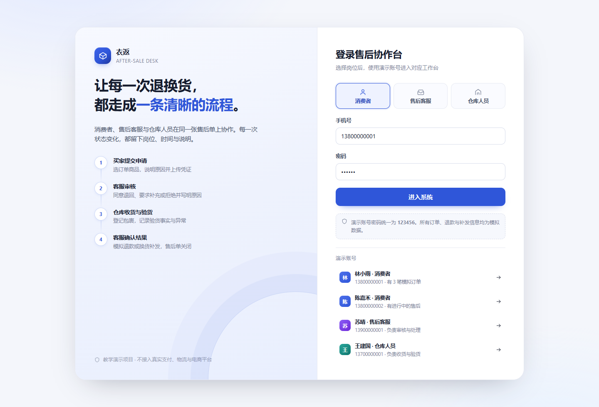
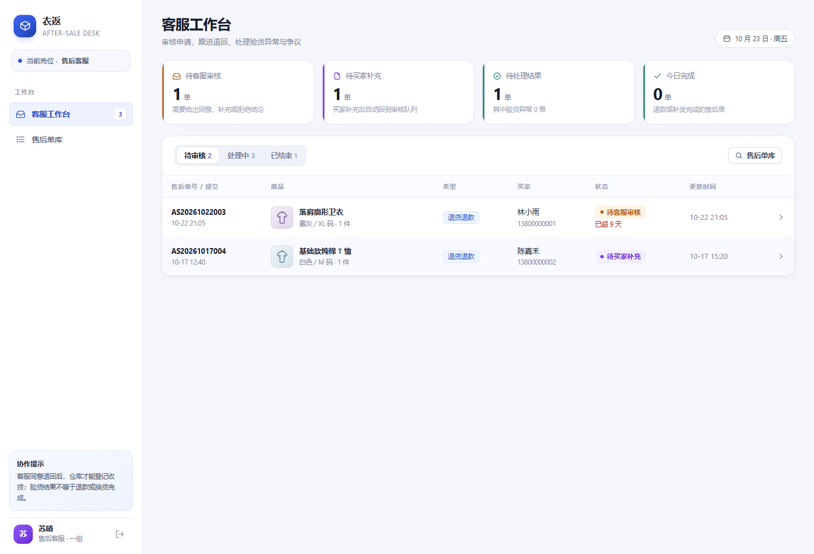
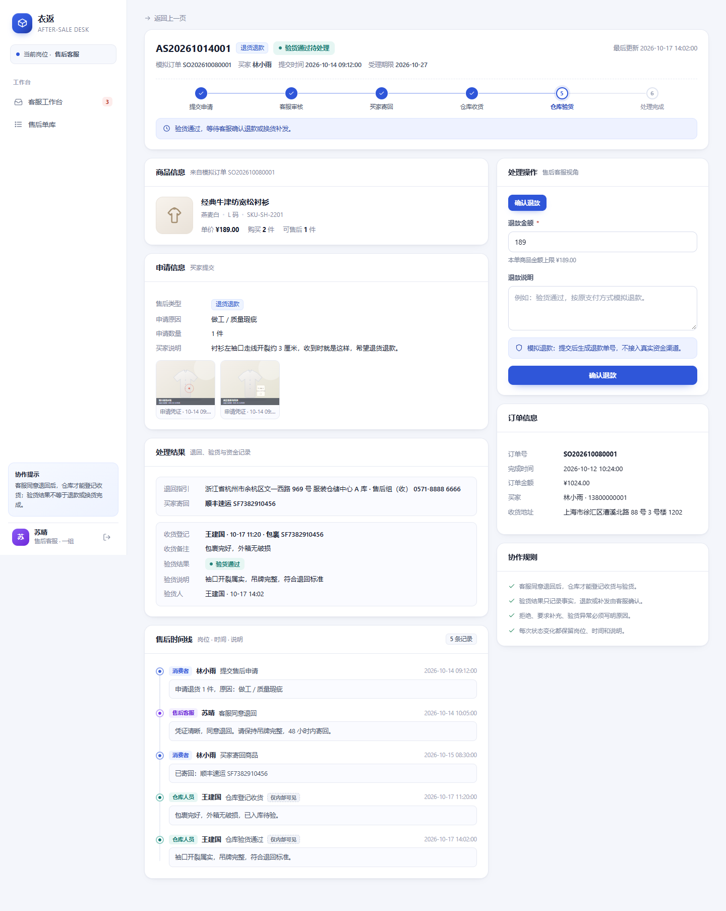
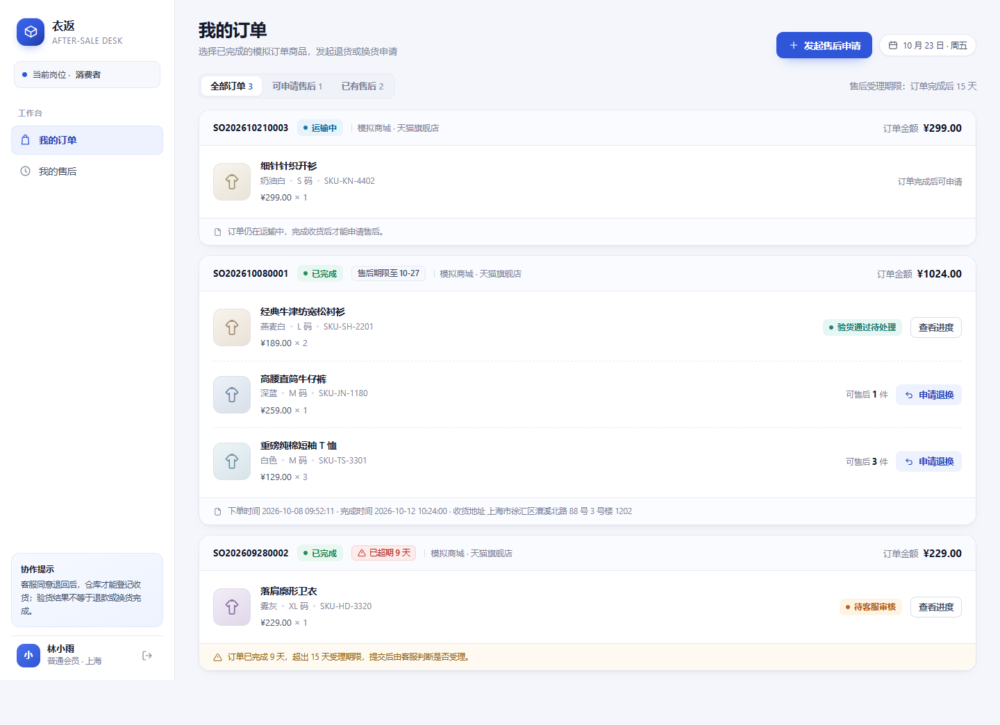
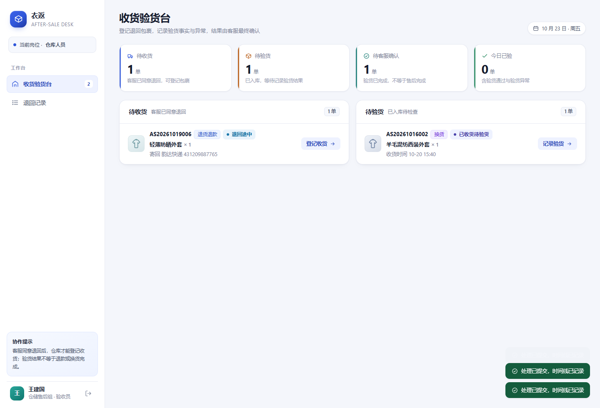

# 衣返 · 服装网店退换货处理系统

> 对应「AI 全栈金课」贯穿式大作业 · **选题二：服装网店退换货处理系统**  
> 消费者、售后客服、仓库人员在同一条售后单上协作，每一次状态变化都留下岗位、时间与说明。



---

## 1. 快速开始

```bash
# 环境：Node.js >= 22.13 + MySQL 8.0（本项目使用 MySQL 存储数据）
npm install

# 1. 配置数据库连接：复制模板，填入本机 MySQL 账号密码
cp .env.example .env
#    Windows 可用：copy .env.example .env

# 2. 启动（首次启动会自动建库、建表并写入模拟数据）
npm start
# 打开 http://localhost:3000
```

数据库只需在 MySQL 中有一个可用的账号（默认 `root`），**库和表由程序自动创建**，不需要手动执行 SQL。

| 命令              | 作用                                    |
| --------------- | ------------------------------------- |
| `npm start`     | 启动服务（首次启动自动建库建表并写入模拟数据）               |
| `npm run reset` | 删除并重建数据库，重新生成模拟数据                     |
| `npm test`      | 运行 9 组核心验收场景自动化测试（独立测试库，不影响演示数据）      |

> 说明：本项目只模拟售后协作，不接入真实电商平台、支付、快递接口。所有订单、退款单号、补发单号均为模拟数据。

### 数据库配置

连接信息从 `.env` 读取（该文件已加入 `.gitignore`，不会提交）：

```ini
DB_HOST=127.0.0.1
DB_PORT=3306
DB_USER=root
DB_PASSWORD=你的密码
DB_NAME=clothes_after_sale
```

默认库名 `clothes_after_sale`，测试库为 `clothes_after_sale_test`，两者互不干扰。

### 容器化运行（不用装 Node 和 MySQL）

机器上只要装了 Docker，一条命令就能跑起来：

```bash
docker compose up -d --build
# 打开 http://localhost:3000
```

| 命令 | 作用 |
| --- | --- |
| `docker compose up -d --build` | 构建并后台启动应用 + MySQL |
| `docker compose ps` | 查看状态，两个服务都是 `healthy` 即就绪 |
| `docker compose logs -f app` | 实时看应用日志 |
| `docker compose down` | 停止并删除容器（数据保留） |
| `docker compose down -v` | 连数据一起清空 |

容器方式的数据库与本地 MySQL 完全隔离（映射到本机 `3307`），数据存在 Docker 卷 `clothes-mysql-data`。完整说明见 [docs/Docker部署说明.md](docs/Docker部署说明.md)，包含数据备份、镜像导出、推送到镜像仓库与常见问题。


## 2. 演示账号

密码统一为 `123456`。

| 姓名  | 手机号         | 岗位   | 演示数据                               |
| --- | ----------- | ---- | ---------------------------------- |
| 林小雨 | 13800000001 | 消费者  | 3 笔订单：可新发起售后、1 单待审核且已超期、1 单验货通过待处理 |
| 陈嘉禾 | 13800000002 | 消费者  | 有「待买家补充」与「换货已收货待验货」各 1 单           |
| 周可  | 13800000003 | 消费者  | 1 单已完成退款、1 单退回途中；可用于验证「不能查看他人售后」   |
| 苏晴  | 13900000001 | 售后客服 | 待审核 / 待补充 / 待处理结果 / 已完成            |
| 何楠  | 13900000002 | 售后客服 | 与苏晴同权限，历史单据操作人                     |
| 王建国 | 13700000001 | 仓库人员 | 待收货 1 单、待验货 1 单                    |

登录页支持按岗位一键填入演示账号。

---

## 3. 角色与权限

| 能力             | 消费者        | 售后客服 | 仓库人员             |
| -------------- | ---------- | ---- | ---------------- |
| 查看订单           | 仅本人        | —    | —                |
| 查看售后单          | 仅本人        | 全部   | 仅已进入仓库环节（待寄回及之后） |
| 发起售后           | ✅ 仅本人已完成订单 | —    | —                |
| 审核 / 要求补充 / 拒绝 | —          | ✅    | —                |
| 登记收货 / 验货      | —          | —    | ✅                |
| 确认退款 / 换货补发    | —          | ✅    | —                |
| 处理验货异常         | —          | ✅    | —                |
| 重新审核被拒申请       | —          | ✅    | —                |

权限在服务端统一校验（`assertVisible`、`actionsFor`、`ACTION_DEFS.roles`），不能通过修改前端绕过。

## 4. 业务流程与状态机

```text
买家选择订单商品并提交申请
  → 客服审核（同意 / 要求补充 / 拒绝）
  → 买家补充材料 或 按退回指引寄回
  → 仓库登记收货
  → 仓库验货（通过 / 异常）
  → 客服确认模拟退款 / 换货补发 / 异常结论
  → 售后单关闭
```

| 状态                      | 含义           | 可执行操作（岗位）                   |
| ----------------------- | ------------ | --------------------------- |
| `pending_review` 待客服审核  | 新申请、补充后、重新审核 | 同意退回 / 要求补充 / 拒绝（客服）；撤销（买家） |
| `need_info` 待买家补充       | 客服要求补充材料     | 补充材料 / 撤销（买家）；拒绝（客服）        |
| `rejected` 已拒绝          | 拒绝原因必填，买家可见  | 重新审核（客服）                    |
| `awaiting_return` 待买家寄回 | 客服同意，写入退回地址  | 填写寄回信息 / 撤销（买家）；登记收货（仓库）    |
| `return_shipped` 退回途中   | 买家已填寄回单号     | 登记收货（仓库）                    |
| `received` 已收货待验货       | 仓库已登记包裹      | 提交验货结果（仓库）                  |
| `inspected` 验货通过待处理     | 只记录验货事实      | 确认退款 / 确认补发（客服）             |
| `inspect_issue` 验货异常    | 异常类型 + 说明必填  | 处理验货异常：拒绝 / 部分退款 / 仍补发（客服）  |
| `completed` 已完成         | 退款或补发完成，单据关闭 | —                           |
| `cancelled` 已撤销         | 买家在收货前撤销     | —                           |

关键设计：**「仓库收货」「验货通过」「退款/补发完成」是三个不同的业务事实**，验货不会自动结束售后单。

## 5. 首版范围

**已实现**

- 模拟订单、订单商品、可售后数量计算
- 退货退款 / 换货两种售后类型
- 申请原因、数量、说明、图片凭证（最多 4 张，自动压缩）
- 客服审核：同意退回、要求补充、拒绝、重新审核
- 仓库收货、验货、异常类型与问题登记
- 换货补发单号、模拟退款金额与退款单号
- 售后时间线、三类角色工作台、售后单检索
- 售后期限提示（订单完成后 15 天）、超期标记与客服判断

**首版不做**（与选题要求一致）

- 商品浏览、购物车、真实下单与支付
- 真实电商平台、快递轨迹、资金渠道对接
- 真实商品质量责任判定、复杂优惠分摊、跨境税费、多仓退货

## 6. 业务规则如何落地

| 规则                | 实现位置                                                 | 系统表现               |
| ----------------- | ---------------------------------------------------- | ------------------ |
| 只能对本人已完成的模拟订单申请售后 | `POST /api/cases` 校验 `user_id`、`order_status`        | 他人订单 403、未完成订单 409 |
| 申请数量不能超过可售后数量     | `availableQty()` 汇总该商品未被拒绝/撤销的申请数量                   | 超出时 409 并提示剩余件数    |
| 同一商品不能重复申请        | 存在 `ACTIVE` 状态售后单时拦截                                 | 返回「已有进行中的售后单」      |
| 客服同意退回后仓库才能收货     | `receive.states = [awaiting_return, return_shipped]` | 提前收货被 409 拦截       |
| 仓库验货不等于退款/换货完成    | `inspect` 只置为 `inspected` / `inspect_issue`          | 必须由客服再确认结果         |
| 拒绝、补充、验货异常必须填原因   | 各操作 `needText()` 校验                                  | 空原因返回 400          |
| 每次状态变化保留岗位、时间、说明  | 所有操作统一写入 `timeline` 表                                | 详情页时间线可追溯          |
| 并发处理同一张单只能成功一次    | 更新语句带状态条件 `WHERE id=? AND status=?`，影响行数为 0 即回滚 | 后到的一方收到 409，需刷新重试 |
| 仓库作业记录不对外展示       | `timeline.visible_to_consumer`，消费者查询时过滤                 | 买家只看到状态，客服看全量     |
| 关闭时间可统计           | 进入终态时写入 `closed_at`                                 | 工作台「今日完成」按关闭时间统计  |
| 普通消费者不能查看他人资料     | 列表按角色过滤 + `assertVisible()`                          | 详情/凭证图片均返回 403     |
| 退款不接真实资金          | 生成 `refund_no` 与金额记录                                 | 页面标注「模拟退款」         |
| 换货必须记录补发单号        | `exchange`、`resolve_issue(exchange)` 校验 `tracking`   | 完成后买家可见补发信息        |

## 7. 数据模型

| 表             | 作用      | 关键字段                                            |
| ------------- | ------- | ----------------------------------------------- |
| `users`       | 三类岗位账号  | `role`（consumer / service / warehouse）          |
| `orders`      | 模拟订单    | `status`、`completed_at`（售后期限起点）                 |
| `order_items` | 订单商品    | `qty`、`unit_price`、颜色/尺码/SKU                    |
| `cases`       | 售后单主表   | `type`、`status`、`qty`、退款与补发字段、`closed_at`（关闭时间） |
| `attachments` | 图片凭证    | `scene`（apply / supplement）、`MEDIUMBLOB`         |
| `inspections` | 收货与验货记录 | `received_at`、`result`、`issue_type`             |
| `timeline`    | 操作时间线   | `role`、`actor`、`action`、`note`、`status_from/to`、`visible_to_consumer` |

关系：`orders 1—N order_items`，`order_items 1—N cases`，`cases 1—N attachments / timeline`，`cases 1—1 inspections`。

存储引擎为 InnoDB，外键约束真实生效；金额字段使用 `DECIMAL(10,2)` 避免浮点误差，时间为 `DATETIME`。
发起售后、执行操作这两条写路径都跑在事务里（`db.js` 的 `tx()`），主单、时间线、验货记录、凭证要么全部成功，要么整体回滚。


## 8. 接口一览

| 方法   | 路径                           | 说明                                        |
| ---- | ---------------------------- | ----------------------------------------- |
| POST | `/api/login` / `/api/logout` | 登录（Cookie 会话）、退出                          |
| GET  | `/api/me` / `/api/meta`      | 当前用户、业务字典（原因/异常类型/期限）                     |
| GET  | `/api/orders`                | 本人订单与每个商品的可售后数量、进行中售后                     |
| GET  | `/api/cases`                 | 售后单列表（按角色过滤，支持 `bucket` / `status` / `q`） |
| GET  | `/api/cases/:id`             | 售后单详情（含时间线、凭证、可执行操作）                      |
| POST | `/api/cases`                 | 发起售后（校验归属、订单状态、数量、重复申请）                   |
| POST | `/api/cases/:id/actions`     | 统一操作入口：审核、收货、验货、退款、补发、补充、寄回、撤销            |
| GET  | `/api/workbench`             | 工作台待办统计                                   |
| GET  | `/api/attachments/:id`       | 凭证图片（校验售后单可见性）                            |

所有状态流转集中在 `ACTION_DEFS` 状态机中，前端按钮由服务端返回的 `availableActions` 驱动，界面与后端规则保持一致。

## 9. 页面结构

| 角色   | 页面                                                  |
| ---- | --------------------------------------------------- |
| 消费者  | 我的订单（可申请/已有售后筛选）→ 发起售后弹窗 → 我的售后 → 售后详情              |
| 售后客服 | 客服工作台（待审核/处理中/已结束 + KPI）→ 售后详情（审核、退款、补发、异常结论）→ 售后单库 |
| 仓库人员 | 收货验货台（待收货/待验货 + KPI）→ 售后详情（登记收货、提交验货结果）→ 退回记录       |

| 客服工作台 | 售后单详情 |
| --- | --- |
|  |  |

| 消费者订单 | 仓库收货验货台 |
| --- | --- |
|  |  |

## 10. 验收场景

9 条核心验收场景均已通过自动化测试（`npm test`，47 项检查）：

1. 消费者能对本人已完成订单商品发起退货或换货；
2. 超过可售后数量、重复申请、未完成订单被拒绝；
3. 客服要求补充材料，买家补充后重新进入审核；
4. 未经客服同意，仓库不能登记收货（不可见且不可操作）；
5. 仓库验货异常后，客服继续处理并留下结论；
6. 普通消费者不能查看他人订单与售后资料；
7. 两个客服并发同意退回，只有一个成功，时间线只写一条；
8. 仓库收货与验货记录仅内部可见，消费者拿不到验货明细；
9. 进入终态写入 `closed_at`，工作台按关闭时间统计当日完成量。

详细手工验收步骤与自动化测试输出见 [docs/验收测试记录.md](docs/验收测试记录.md)。

## 11. 目录结构

```text
Clothes/
├─ server.js                 # Express 服务、权限、状态机、REST 接口
├─ db.js                     # MySQL 连接池、建表、事务封装、模拟数据
├─ .env.example              # 数据库配置模板（复制为 .env）
├─ Dockerfile                # 应用镜像：多阶段构建、非 root、健康检查
├─ docker-compose.yml        # 应用 + MySQL 编排、数据卷、启动依赖
├─ .dockerignore             # 排除 node_modules/.env，避免密码进镜像
├─ public/                   # 无构建步骤的前端单页应用
│  ├─ index.html
│  ├─ styles.css
│  └─ app.js
├─ test/acceptance.js        # 9 组核心验收场景自动化测试（独立测试库）
├─ scripts/reset.js          # 重建演示数据库
└─ docs/                     # 交付文档、Docker 部署说明与界面截图
```

## 12. 设计取舍

- **为什么用 MySQL**：课程要求关系型数据库，InnoDB 的外键、事务、索引与 `DECIMAL` 金额类型更贴近真实电商系统；同时为多实例部署留出空间。
- **为什么库表由程序自动创建**：`npm start` 时检测并建库建表，评审者只需一个能连的 MySQL 账号，不用手动执行 SQL 脚本。启动时先尝试直连目标库，库已存在就不需要建库权限，因此容器里可以只给业务账号。
- **为什么容器拆成 app + mysql 两个**：数据库有状态、应用无状态，分开才能单独升级应用而保留数据；两者通过 compose 服务名互访，镜像里不放数据库，避免"数据跟着镜像走"。
- **为什么镜像用多阶段构建**：构建阶段装依赖、运行阶段只留 `node_modules` 与源码，镜像更小；`.dockerignore` 排除 `.env`，数据库密码不会被打进镜像层。
- **为什么查数据库统一走 `get / all / run` 三个封装**：`mysql2` 返回的 `[rows, fields]` 与 SQLite 风格不同，封装一层后业务代码只关心 SQL 与参数，事务里也能复用同一组方法。
- **为什么写操作放进事务**：售后单、时间线、验货记录、凭证是强关联数据，中途失败会留下「有单没记录」的脏数据；`tx()` 保证原子性。
- **为什么操作入口统一为 `/api/cases/:id/actions`**：所有状态流转、角色校验、必填原因、时间线留痕集中在一处，避免「前端能点但后端没拦住」。
- **为什么由服务端返回 `availableActions`**：界面按钮与业务状态机同源，减少页面状态与后端规则不一致。
- **为什么用状态条件更新而不是行锁**：`UPDATE ... WHERE id=? AND status=?` 把读到的状态当作版本号，不需要显式加锁，也不会出现「两个客服同时点同意，后一次覆盖前一次」；冲突直接返回 409 让前端刷新，比排队等锁更符合客服工作台的交互。
- **为什么时间线要分内外**：仓库登记收货、验货是内部作业动作，包含包裹号、破损描述等不适合直接对买家展示的细节。用 `visible_to_consumer` 在服务端过滤，而不是前端隐藏，避免越权接口把内部备注带出去。
- **图片凭证存 `MEDIUMBLOB`**：演示环境不引入对象存储，上传后由受权限保护的接口输出。
- **已知限制**：会话存放在内存（重启需重新登录）；演示密码为固定值的 SHA-256 哈希；未做连接池之外的读写分离与缓存。

## 13. 参考实现对照

设计上参考了同选题的 Java 实现 [chos1nwp/clothing-aftersales](https://github.com/chos1nwp/clothing-aftersales)（Spring Boot + MyBatis + MySQL）。该仓库**未声明开源许可证**，因此这里只借鉴思路，代码按本项目的 Node.js 技术栈重写，没有复制源文件。

| 参考实现的做法 | 是否采纳 | 在本项目的落地 |
| --- | --- | --- |
| 状态条件更新（`where id=? and status=?`）拦截并发 | 采纳 | `server.js` 执行操作时校验 `affectedRows`，为 0 抛 409；测试场景 7 用两个客服账号并发验证 |
| 时间线区分内部记录与消费者可见记录 | 采纳 | `timeline.visible_to_consumer`，消费者查询时服务端过滤，验货明细整体不下发 |
| `closed_at` 关闭时间 | 采纳 | 进入终态时写入，工作台「今日完成」按它统计 |
| 按课程章节组织交付文档 | 部分采纳 | 已补 `docs/Docker部署说明.md` 与验收记录；章节化文档不重复建设 |
| 统一响应封套 `{code,data,message}` | 不采纳 | 现有接口统一用 HTTP 状态码 + `{error}`，前端已适配；改造要动全部调用点，收益有限 |
| 凭证存本地磁盘（UUID 重命名） | 不采纳 | 本项目凭证存 MySQL `MEDIUMBLOB`，容器化后无需挂载目录，备份只针对数据库 |
| 收货不推进单据状态 | 不采纳 | 本项目把「已收货待验货」作为独立状态，语义等价，仓库工作台可直接按状态筛选 |
| Java / Spring Boot 技术栈 | 不采纳 | 课程未限定语言，Node 版本已完成并通过全部测试，换栈没有额外收益 |

> 参考仓库的其余工程实践（`@RequireRole` 注解、MyBatis XML 管理 SQL、脚本化验收）与本项目已有的 `requireRole()` 中间件、数据层封装、`test/acceptance.js` 属于同类做法，未重复引入。
